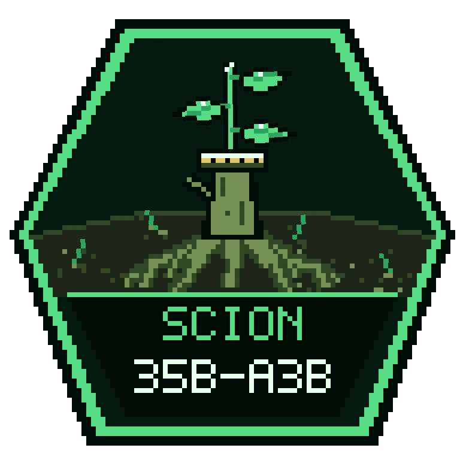
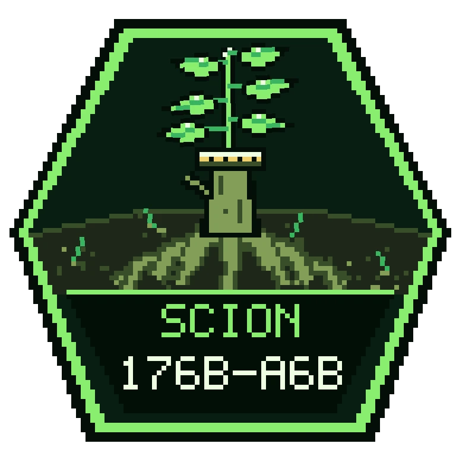
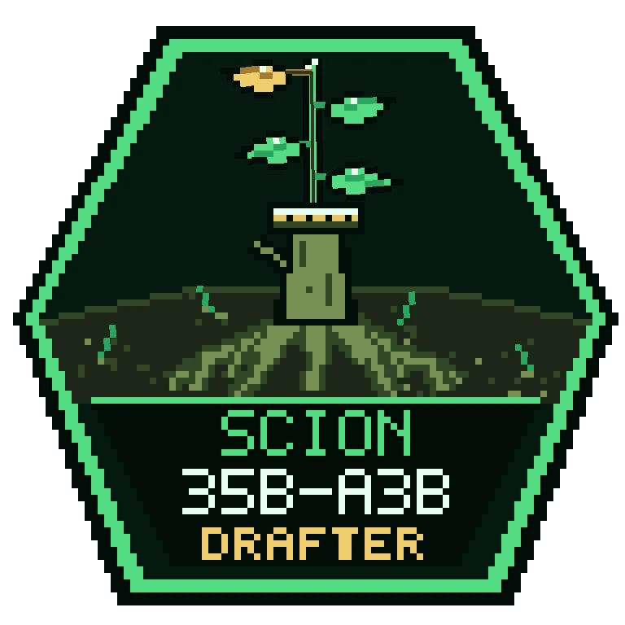
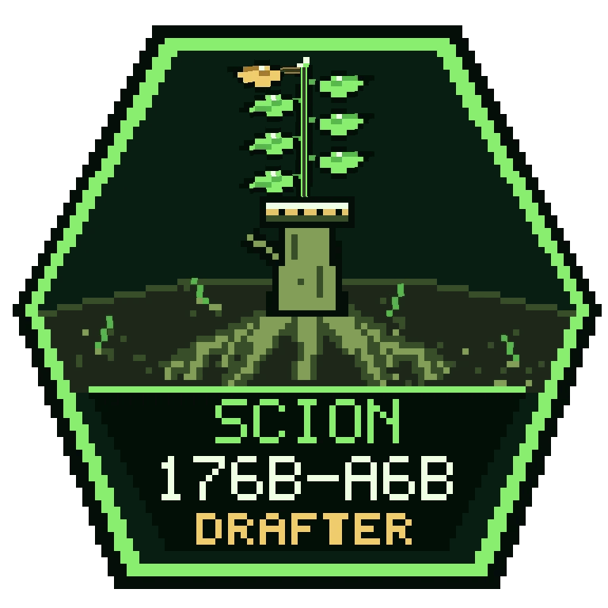
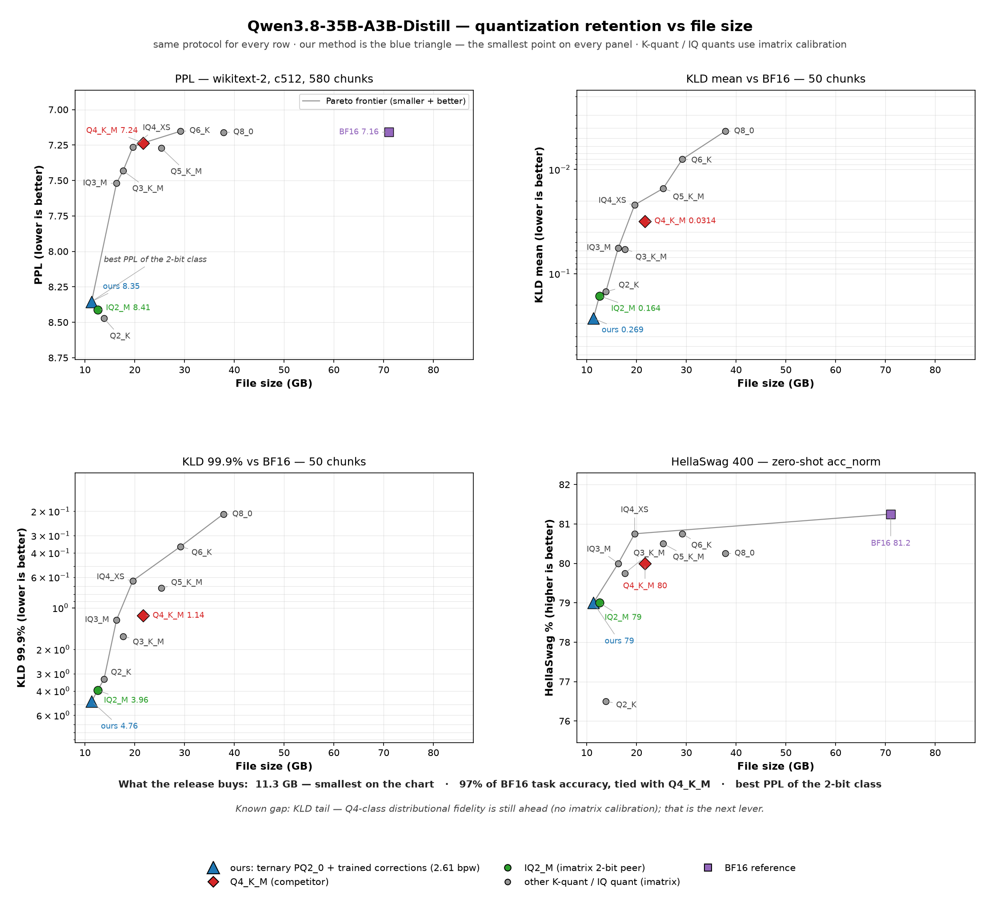

# Scion: ternary quantization with trained corrections

Scion is the project behind the released
[**Scion-35B-A3B**](https://huggingface.co/SkyIsNotGreen/Scion-35B-A3B),
[**Scion-FlashNext-176B-A6B**](https://huggingface.co/SkyIsNotGreen/Scion-FlashNext-176B-A6B),
and their optional MTP drafters:
[35B](https://huggingface.co/SkyIsNotGreen/Scion-35B-A3B-mtp-drafter) and
[176B](https://huggingface.co/SkyIsNotGreen/Scion-FlashNext-176B-A6B-mtp-drafter).
It was split out of
[bonsai2-ternary-forensics](https://github.com/sky-is-green/bonsai2-ternary-forensics)
so the harness, the port decisions and the release docs can be cloned and run on
their own.

<p align="center">
  <a href="https://huggingface.co/SkyIsNotGreen/Scion-35B-A3B"></a>
  <a href="https://huggingface.co/SkyIsNotGreen/Scion-FlashNext-176B-A6B"></a>
  <br>
  <a href="https://huggingface.co/SkyIsNotGreen/Scion-35B-A3B-mtp-drafter"></a>
  <a href="https://huggingface.co/SkyIsNotGreen/Scion-FlashNext-176B-A6B-mtp-drafter"></a>
</p>

**The idea.** Ternarise the expert banks of a pretrained MoE in place, then
recover the routing damage with small trained corrections on the residual
stream. No full-precision masters and no full-model QAT. The 35B body ships at
2.125 bpw expert banks (`Q2_0_g128`; `PQ2_0` in the fork) and 11.34 GB total;
the 176B ships 1.75 bpw expert banks (`TQ1_0_g128`; `PTQ1_0` in the fork). The
corrections are rank-512 branches on the attention output and the MoE block
output, plus router deltas, trained by output-KD **with the deployed quantizer
in the loop**. The 35B drafter is a small trained k=1 sidecar. The 176B drafter
is Qwen's own native MTP block, packed back with zero training.

## Releases (2026-11)

| model | what | size | runtime | status |
|---|---|---|---|---|
| [**Scion-35B-A3B**](https://huggingface.co/SkyIsNotGreen/Scion-35B-A3B) | ternary Qwen3.8-35B-A3B distill + trained corrections | 11.34 GB | Prism `moe-corr-runtime` / Strata | released; runtime v0.4.2; CPU and ROCm verified, CUDA/Windows published but runtime-unverified |
| [**Scion-35B-A3B-mtp-drafter**](https://huggingface.co/SkyIsNotGreen/Scion-35B-A3B-mtp-drafter) | k=1 MTP sidecar, trained self-distill | 50 MB | Prism `-md` | released; ~1.2x generation |
| [**Scion-FlashNext-176B-A6B**](https://huggingface.co/SkyIsNotGreen/Scion-FlashNext-176B-A6B) | ternary FlashNext 176B + 51.2B n-gram table + trained corrections | 57.62 GB default; 60.17 GB Q4_0 table; 65.8 GB F16 | Prism `qwen4exp-proto` / Strata | released 2026-10-05 |
| [**Scion-FlashNext-176B-A6B-mtp-drafter**](https://huggingface.co/SkyIsNotGreen/Scion-FlashNext-176B-A6B-mtp-drafter) | native MTP block, zero training | 0.89 GB | **Strata only** | released 2026-11-15 |
| Scion-35B v2 | long-horizon correction retrain | — | — | planning; [plan](v2/PLAN.md), [lessons](v2/LESSONS.md) |

The 35B v2 lane is a frozen-body correction retrain aimed at long-horizon work:
the shipped 35B scores 14.4% on the hard-90 suite and derails into repetition
at 5-10k generated tokens. The plan and the lessons so far are in
[`v2/PLAN.md`](v2/PLAN.md) and [`v2/LESSONS.md`](v2/LESSONS.md).

Negative results are kept in [`FAILURES.md`](FAILURES.md); runtime support
boundaries and what a backend report must carry are in
[`docs/PLATFORM-SCOPE.md`](docs/PLATFORM-SCOPE.md).

## Runtime boundary

Scion owns the model, the training, the codecs and the export. The reference
loader is the Prism `qwen4exp` llama.cpp fork; Strata is the second runtime.
The 35B and 176B bodies run on the fork (branches below), the 35B drafter is an
`-md` sidecar, and the 176B native MTP drafter is **Strata-only** — it is not
loadable as a llama.cpp sidecar. Container types and the correction contract
are in [`SCION_RUNTIME.md`](SCION_RUNTIME.md); core tests run without a Strata
checkout.

## Release: Scion-35B-A3B

`empero-ai/Qwen3.8-35B-A3B-Distill` (a Qwen3.8-line distill on
`Qwen/Qwen3.6-35B-A3B`), ternary experts, Q8_0 rest and embedded corrections:
**11.34 GB / 2.61 bpw** in one file, no `--lora` step.

| metric | **Scion-35B-A3B** | Q4_K_M | BF16 |
|---|---|---|---|
| PPL, wikitext-2, c512, 580 chunks | **8.354** | 7.235 | 7.160 |
| KLD mean vs BF16, 50 chunks | 0.269 | 0.031 | — |
| HellaSwag 400 | 79.00 | 80.00 | 81.25 |
| Winogrande 400 | **76.25** | 76.00 | 76.00 |

Task accuracy is inside the ±2% noise band, PPL is the best of the 2-bit class,
and the KLD tail is the known gap and the current work item
(`docs/TAIL-EXPERIMENT-PLAN.md`). The full table against every community quant
of the same model is in `docs/QUANT-RETENTION-35B.md`.



The grid shows file size (left is smaller) against quality, with the PPL and KLD
axes inverted so the better end is up. Every row uses the same protocol.

Card and weights:
[`SkyIsNotGreen/Scion-35B-A3B`](https://huggingface.co/SkyIsNotGreen/Scion-35B-A3B).
A snapshot of the card is kept at `docs/RELEASE-35B-MODEL-CARD.md`. The repo
also ships an optional decision head: a correctness readout
(`EMB 2048 <file> <p_correct>`) for agents that need a confidence gate.

### 35B MTP drafter

The optional **50 MB k=1 MTP drafter** is a trained self-distill (3,088 windows,
67-83% acceptance). It drafts the next token from the model's own hidden state
and gives about 1.2x generation (up to 1.37x on the bench prompt) with unchanged
outputs. Pass it with `-md` only: the sidecar is detected from the GGUF. Do not
add `--spec-type draft-mtp` (that selects the MTP head inside a full model and
fails with `unknown model architecture: 'mtp'`); the sidecar's explicit type
name is `draft-mtp-sidecar`.

## Release: Scion-FlashNext-176B-A6B

`Qwen/Qwen3.8-Flash-Next-FP8` quantized to **2.60-2.72 bpw** in the ternary
containers: the 125B language model (6B activated per token, 512 experts top-10)
plus the 51.2B-parameter n-gram table in a single file. Ternary `TQ1_0_g128`
expert banks at 1.75 bpw (`PTQ1_0` in the fork) with embedded corrections;
body Q6_K+Q8_0 or F16.

| container | size | notes |
|---|---|---|
| Q6_K + Q4X160 table (default) | 57.62 GB | 2.60 bpw; smallest |
| Q6_K + Q4_0 table | 60.17 GB | 2.72 bpw |
| F16 body | 65.8 GB | fidelity variant |

| metric (one harness, Q6_K/Q4_0 table) | **Scion-FlashNext** | ISTA GSQ-RCO Q2_0 |
|---|---|---|
| HellaSwag 400 | **82.00** | 81.50 |
| Winogrande 400 | **77.50** | 74.75 |
| wikitext-2 PPL | 5.457 | **5.240** |

Measured with Strata on the 2x RX 7900 XT box (Q4_0-table file): **80.5-80.8
tok/s** generation, 12.4 ms/token, 2.3-2.4 tokens per pipeline window.

Card and weights:
[`SkyIsNotGreen/Scion-FlashNext-176B-A6B`](https://huggingface.co/SkyIsNotGreen/Scion-FlashNext-176B-A6B);
snapshot at `docs/RELEASE-FLASHNEXT-176B-A6B-MODEL-CARD.md`. The body runs on
the fork's `qwen4exp-proto` branch or Strata; stock llama.cpp cannot load it.

## Release: Scion-FlashNext-176B-A6B native MTP drafter

Qwen's own MTP block is present in the BF16 checkpoint but is dropped by
llama.cpp's converter (`supports_mtp_export = false`). This pack restores the
31 `mtp.*` tensors in Strata's runtime layout, so the 176B can draft from its
own hidden state with no training, no distillation and no fitting pass.

| metric | result |
|---|---|
| Draft acceptance (weighted, 10 mixed greedy prompts, 256 tok) | **0.741** (1310/1769), 0.640-0.810 per request |
| Draft acceptance (30 long-form generations, T 0.6) | 0.62-0.72 per request |
| Decode (2x RX 7900 XT, Q6_K, `--spec 4`) | 52-78 tok/s |
| Prefill, ~450-token prompts | 116-135 tok/s |

0.89 GB; Q2_0 round-to-nearest experts and BF16 dense tensors. **Strata only:**
this is not a llama.cpp `-md` sidecar, and the fork's `draft-mtp-sidecar` lane
does not load it. Convert once and serve with `--mtp mtp/rt --spec 4`; the full
command, provenance manifest and tensor hashes are on the
[card](https://huggingface.co/SkyIsNotGreen/Scion-FlashNext-176B-A6B-mtp-drafter)
and in [`v2/mtp-drafter-release/`](v2/mtp-drafter-release/).

## What the experiments established

- routing drift compounds and is the dominant failure mode (`docs/MOE-EXTENSION.md` §2.1);
- rotation is not the missing lever for MoE (§2.2);
- in-place ternary QAT on its own does not recover it at local budgets (§2.3);
- corrections must live on the **residual stream**, not inside experts; that is the placement rule (§2.4);
- router-KD is a verified no-op, and the correction repairs the state the router reads instead (§2.4a);
- train the sidecar in the deployed format, because post-hoc ternarisation is 14 to 25 times worse (§2.4c);
- the deployable Lloyd quantizer beats one-shot absmean (§2.4d);
- `attn_out` ships as a standard llama.cpp LoRA, and the better `moe_out` placement needs the ~90-line fork extension (§2.4e).

An earlier proof on the frozen proxy `allenai/OLMoE-1B-7B-0924`: the uncorrected
mixed GGUF measured **566.7 PPL, and 14.48** with both placements and routers
(2.12 GB body, 22.2 MB adapter), with CPU and HIP builds agreeing.

## Quickstart

**Run a release.** The 35B and 176B bodies need the runtime fork,
[`sky-is-green/prism-ml-llama.cpp`](https://github.com/sky-is-green/prism-ml-llama.cpp).
The 35B loads on `moe-corr-runtime`; Flash-Next needs `qwen4exp-proto`. Build
once per branch and run:

```bash
git clone -b moe-corr-runtime https://github.com/sky-is-green/prism-ml-llama.cpp
cd prism-ml-llama.cpp
./verify-container-support.sh          # prints RESULT: OK
cmake -B build -DGGML_CUDA=ON          # or -DGGML_HIP=ON, or no flag for CPU
cmake --build build -j --target llama-cli llama-server

# weights
hf download SkyIsNotGreen/Scion-35B-A3B Scion-35B-A3B-PQ2_0-corr.gguf --local-dir .
hf download SkyIsNotGreen/Scion-35B-A3B-mtp-drafter Scion-35B-A3B-mtp-drafter.gguf --local-dir .

# Scion-35B-A3B with the drafter
./build/bin/llama-server -m Scion-35B-A3B-PQ2_0-corr.gguf \
    -md Scion-35B-A3B-mtp-drafter.gguf -ngl 99 -c 4096 -t 8 --port 8080
```

```bash
# 176B, 48 GB card + >= 64 GB host RAM (clone -b qwen4exp-proto and build first)
hf download SkyIsNotGreen/Scion-FlashNext-176B-A6B \
    Scion-FlashNext-176B-A6B-Q6_K-Q4X160.gguf --local-dir .
./build/bin/llama-server -m Scion-FlashNext-176B-A6B-Q6_K-Q4X160.gguf -ngl 99 \
    --cpu-moe -ot per_layer_token_embd.weight=CPU -fa on --numa distribute \
    -c 4096 --port 8081
```

The 176B native MTP drafter is Strata-only:

```bash
hf download SkyIsNotGreen/Scion-FlashNext-176B-A6B-mtp-drafter \
    Scion-FlashNext-176B-A6B-mtp-drafter.gguf --local-dir .
# in the Strata checkout
python tools/mtp_rt.py --gguf Scion-FlashNext-176B-A6B-mtp-drafter.gguf --out mtp/rt
```

Then add `--mtp mtp/rt --spec 4` to the Strata serve command; the full
invocation is on the
[drafter card](https://huggingface.co/SkyIsNotGreen/Scion-FlashNext-176B-A6B-mtp-drafter).

Recommended sampling and context notes are on each model card. The fork's
`master` is an untouched upstream mirror and cannot load these files; a load
failure saying `invalid ggml type 142` (35B) or `143/146` (176B) means the wrong
branch or an upstream build was used.

**Reproduce the recipe, locally and free: the OLMoE proxy.** Python 3.10 or
newer, torch (ROCm or CUDA wheels), `transformers`, `datasets`, `numpy` and
`pyyaml`. The run sequence is in [`moe/README.md`](moe/README.md). The in-place
ternary QAT negative control is `moe/olmoe_proxy.py` and the correction trainer
is `moe/olmoe_corrections.py`.

**Paths.** The harness resolves its external paths through `moe/scion_paths.py`
and every default is an environment variable
(`SCION_WORKSPACE`, `SCION_MODELS`, `LLAMA_BIN`, `GGUF_PY`, ...). Set
`SCION_WORKSPACE` if models and sibling checkouts live outside the repo's
parent directory.

**The 35B path: one 80 GB GPU.** Quantize the deployment body
locally first (`llama-quantize` with the experts mapped to `pq2_0` and
`GGML_PQ2_0_LLOYD=1`), run the box stages, then merge the exported adapter into
the body with `moe/merge_adapter_into_body.py`:

```bash
bash moe/box-run.sh setup && bash moe/box-run.sh smoke && bash moe/box-run.sh cache
bash moe/box-run.sh ref   && bash moe/box-run.sh train && bash moe/box-run.sh eval && bash moe/box-run.sh export
```

Every stage is resumable, and checkpoints and the teacher cache land on the
volume. Port notes: `moe/PORT-QWEN35.md`; the architecture decision record:
`docs/QWEN35-PORT-DECISION.md`.

## Layout

| path | what |
|---|---|
| `moe/` | the harness: proxies, correction trainers, port, box-run scripts, export and bench tooling, result JSONs |
| `v2/` | 35B v2 planning, FlashNext evals, and the 176B native MTP drafter pack |
| `docs/` | write-ups: the MoE extension, release tables, port decision, tail plan, platform scope, registers |
| `serving/` | serving experiments: placement sweep (ternary vs f16 offload, threads, split modes) and the expert-cache negative result |
| `integrations/strata/` | Strata serving scripts, decision-head clients and fit notes |
| `scion_moe/` | vendored `rotation` and RTN quantizer used by the harness |
| `FAILURES.md` | the negative register for this track (D1-D8) |
| `retention-grid.png` | the release figure (regenerate with `moe/plot_bench.py`, which writes into `moe/results/qwen35-retention/`) |

## Serving notes

- the ternary container roughly **halves the CPU-expert-offload penalty** compared to f16 (2.07 GiB OLMoE: 34% and 50% versus 86% and 75% for prefill and decode);
- **threads should equal physical cores** (`-t 16` collapses generation from 95 to 35 t/s on an 8C/16T CPU);
- do not layer-split when one card fits (40% generation loss);
- `-ncmoe` is the VRAM-budget dial, and placement does not change the math;
- the optional MTP drafter gives about **1.2x generation** on the 35B (up to 1.37x on the bench prompt) with unchanged outputs;
- for the KV cache, `--cache-type-k/v q8_0` is lossless in practice; `q4_0` costs about +0.3% PPL at 4k context on the 35B;
- the 176B body runs on both the fork and Strata; the 80.5-80.8 tok/s figure is Strata, and its native MTP drafter is Strata-only;
- a hot-expert GPU cache gave **no throughput gain**, because `mul_mat_id` computes k experts per token regardless of the weights. It would need sparse per-token dispatch rather than a static split (`serving/placement-sweep-20260927/THROUGHPUT.md`).

## Provenance

Split from
[`sky-is-green/bonsai2-ternary-forensics`](https://github.com/sky-is-green/bonsai2-ternary-forensics)
at `b01f7e2` (2026-09-27). This track's negative register is
[`FAILURES.md`](FAILURES.md).

## License and attribution

Apache-2.0; see [`LICENSE`](LICENSE) and [`NOTICE`](NOTICE). Base models:
**empero-ai** (Apache-2.0) and **Qwen / Alibaba Cloud** (Apache-2.0); container
and kernels: **Prism ML**'s llama.cpp fork (MIT) with **TAARDIS** conventions
(MIT); engine: **llama.cpp** (MIT). Not affiliated with, endorsed by, or
supported by Prism ML, empero-ai, or Alibaba Cloud.
