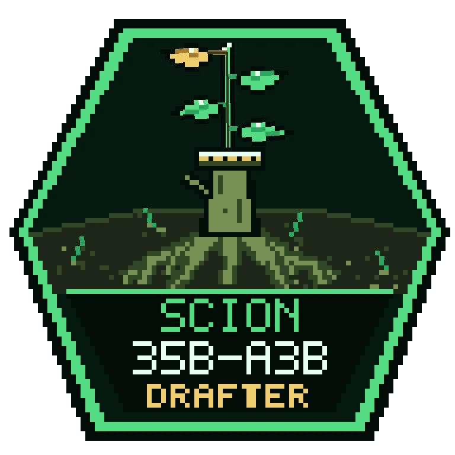
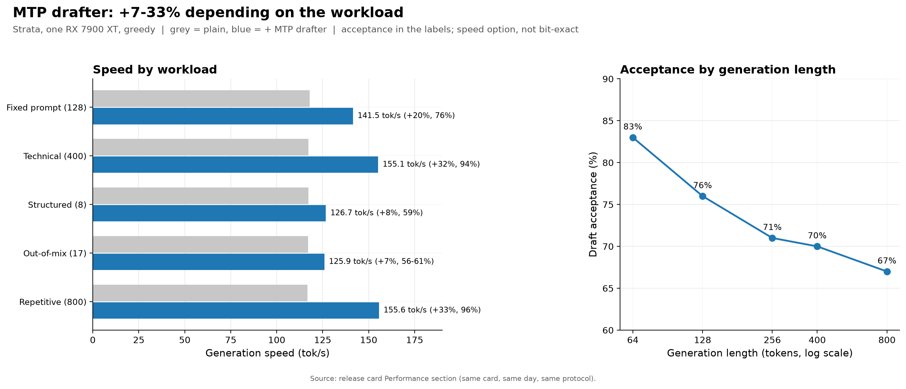

> **Snapshot note.** This is the model card as published on
> [Hugging Face](https://huggingface.co/SkyIsNotGreen/Scion-35B-A3B-mtp-drafter),
> kept here for provenance. The harness lives in this repository; the runtime
> fork is a separate checkout.

# Scion-35B-A3B — k=1 MTP drafter

<p align="center">
  
</p>


A 50 MB frozen-body speculative drafter for
[**Scion-35B-A3B**](https://huggingface.co/SkyIsNotGreen/Scion-35B-A3B). It
predicts the model's own next token from the model's post-norm hidden state plus
the next token's embedding, and reuses the target's own
`output_norm`/`output`/`token_embd` — there is no second vocabulary projection.

Measured on one RX 7900 XT (greedy), paired with the release:

| Workload | Baseline | + drafter | Speedup | Draft acceptance |
| :--- | ---: | ---: | ---: | ---: |
| Bench prompt, 400 tokens | 12.41 ms/tok | 9.07 ms/tok | **1.37×** | 0.738 |
| Open-ended CLI generation | 49.0 tok/s | 57.2 tok/s | **1.17×** | 0.46–0.74 |
| Server confirmation | — | — | 1.14–1.21× | 0.44–0.70 |

Teacher-forced acceptance: fineweb 0.483 / wikitext 0.360. Speedup is
prompt-dependent — treat **~1.2× as the typical figure** and 1.37× as the
benchmark-prompt best. Drafting leaves the model's outputs unchanged apart from
rare near-tie flips on batched verification.

## Requirement: the runtime fork

> **This is not a stock llama.cpp drafter.** It is loaded by the fork's
> `draft-mtp-sidecar` implementation (auto-detected from the GGUF) and runs
> entirely against the target context — no draft model.

Use the runtime fork, branch `moe-corr-runtime`:
[`sky-is-green/prism-ml-llama.cpp`](https://github.com/sky-is-green/prism-ml-llama.cpp/tree/moe-corr-runtime).
The target also needs that fork (the `PQ2_0` container); see the
[model card](https://huggingface.co/SkyIsNotGreen/Scion-35B-A3B) for the build.

## Usage

```bash
hf download SkyIsNotGreen/Scion-35B-A3B Scion-35B-A3B-PQ2_0-corr.gguf --local-dir .
hf download SkyIsNotGreen/Scion-35B-A3B-mtp-drafter Scion-35B-A3B-mtp-drafter.gguf --local-dir .

# server (no extra flags; the sidecar is auto-detected)
./build/bin/llama-server -m Scion-35B-A3B-PQ2_0-corr.gguf \
    -md Scion-35B-A3B-mtp-drafter.gguf -ngl 99 -c 4096 -t 8 --port 8080

# CLI
./build/bin/llama-cli -m Scion-35B-A3B-PQ2_0-corr.gguf \
    -md Scion-35B-A3B-mtp-drafter.gguf -ngl 99 -c 4096 -t 8
```

## Second runtime: Strata

Strata — the project's own engine, the one the model card's Performance section is measured with — reads
a **different** head fitted to its own hidden states: `Scion-35B-A3B-mtp-strata.gguf` (96 MiB) in the
[model repo](https://huggingface.co/SkyIsNotGreen/Scion-35B-A3B).  The two files are not interchangeable:
the head in this repo was fitted to the fork's hiddens and accepts only 38% in Strata, where it is slower
than not drafting at all.

```console
hf download SkyIsNotGreen/Scion-35B-A3B Scion-35B-A3B-mtp-strata.gguf --local-dir .

strata-q36 --model Scion-35B-A3B-PQ2_0-corr.gguf --max-context 4096 --chunk 512 \
    --vram-reserve-mib 3072 --mtp 1 --mtp-sidecar Scion-35B-A3B-mtp-strata.gguf
```

Measured there on one RX 7900 XT, greedy, served: **141.5-142.3 tok/s against 117.9-118.3 plain on the
fixed prompt (+20%, 76% draft acceptance)**, up to **+32% on technical prompts**, +7-8% on structured
output (JSON / YAML / markdown tables) and on prompts outside its training mix, and **long-form held-out
acceptance 50.7% (up from 49.3%)** after a 60-prompt pass over the weakest long-form styles.  Like the fork's sidecar
it is a speed option rather than a bit-exact one (the batched verify can flip a near-tie).  Repeated-token
text - the previous head's worst case at 0-13% acceptance and -24% against plain - is now the best row:
the run is one period-4 stretch, training on those degenerate stretches fixed it, and it measures **+33%
at 96% acceptance**.  For text the head has not seen, `--mtp-period 4` drafts a confirmed period directly
(skipping the head call, leaving the verify untouched) and `--mtp-backoff 8` pauses drafting after a
streak of rejected drafts - both free backstops on ordinary text.



*Strata's own 96 MiB head (`Scion-35B-A3B-mtp-strata.gguf`), not the 50 MB
fork-side file in this repo: 117.9-118.3 -> 141.5-142.3 tok/s on the fixed
prompt (+20%, 76% acceptance), +7-33% across the other workloads, and acceptance
83% at 64 tokens down to 67% at 800.*

## File

| file | size | sha256 |
| :--- | ---: | :--- |
| `Scion-35B-A3B-mtp-drafter.gguf` | 50.3 MB | `2dabf2cf4e6840f9bc497440f69c82d4f315b988d2eaeebd80b879965214a873` |

Trained self-distilled against the release's own greedy tokens on 3088 windows
(1024 fineweb seed 0 + 2048 seed 1 + 16 wikitext) with the body frozen. The k=1
head is the only drafter that pays here; a DSpark-shaped multi-token head was
built and measured for the same release and did **not** beat this one (see the
project's negative register). License Apache-2.0, inherited from the base model.
