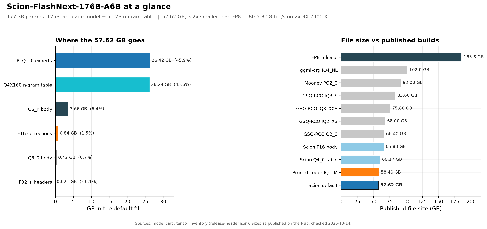
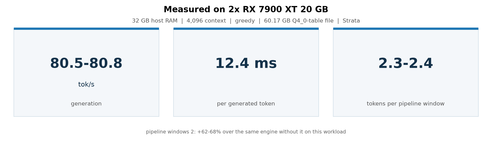
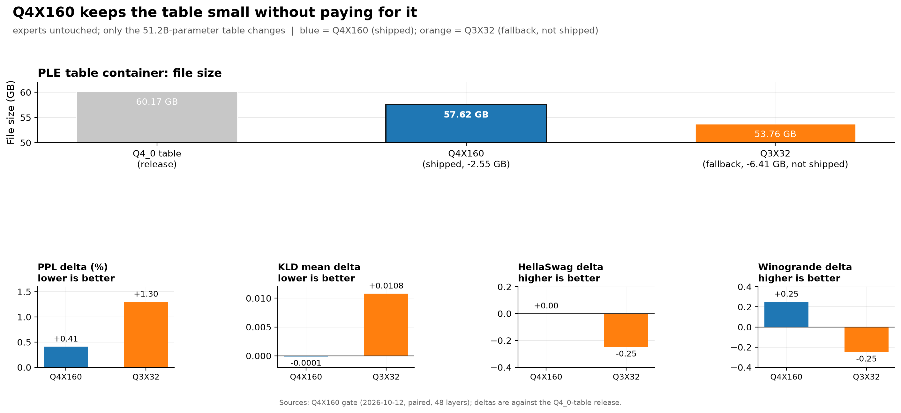
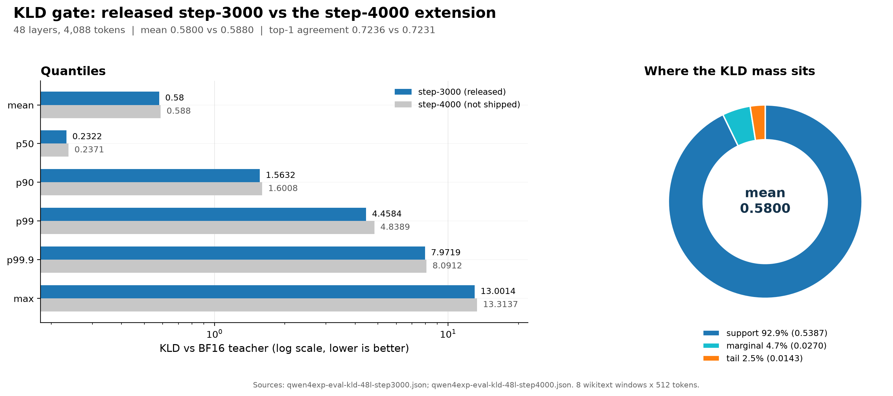
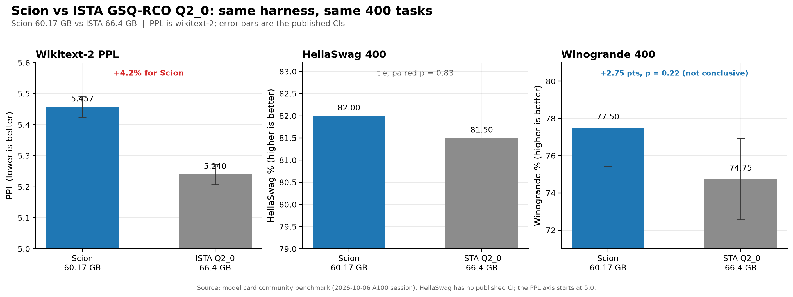
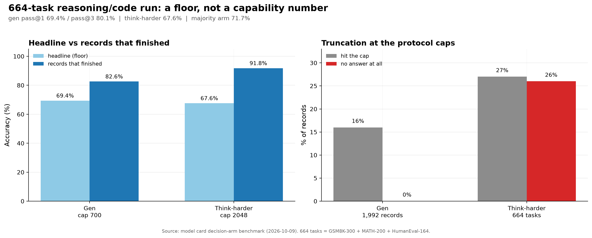
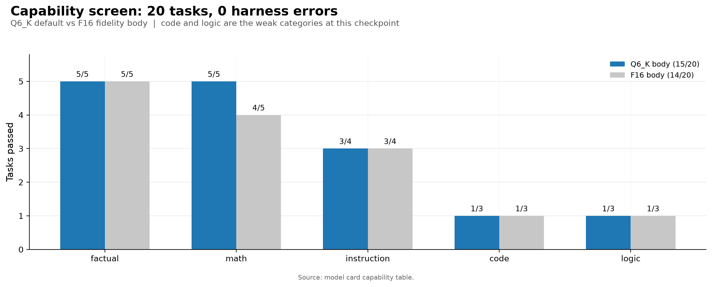

<p align="center">
  <a href="https://github.com/sky-is-green/scion"><b>GitHub: Build-scripts and docs</b></a> &nbsp;|&nbsp;
  <a href="https://github.com/sky-is-green/prism-ml-llama.cpp/tree/qwen4exp-proto"><b>Runtime fork</b></a> &nbsp;|&nbsp;
  <a href="https://huggingface.co/SkyIsNotGreen/Scion-FlashNext-176B-A6B/discussions"><b>Discussions</b></a>
</p>

# Scion-FlashNext-176B-A6B: ternary MoE experts + trained corrections + 4-bit PLE

A full Qwen3.8-Flash-Next in one 57.62 GB GGUF for llama.cpp — **176B
parameters in the file**: the 125B language model (6B activated) plus the
51.2B-parameter n-gram table (the base's 4B MTP head is not included). Ternary
expert banks plus small trained corrections, and the n-gram table (PLE) in the
per-row **Q4X160** container (26.24 GB) — no full-precision masters, no
full-model QAT. Two larger containers ship in the same repo: the Q4_0-table
file at 60.17 GB and the F16-body file at 65.80 GB.

> **2.60 bpw** | **57.62 GB** (3.2x smaller than the FP8 release) | **smallest build of this model published on the Hub that we can see, pruned or not** | **cap_eval 15/20, 0 harness errors** | **HellaSwag 400 82.00%, Winogrande 400 77.50%**

The name comes from grafting. A scion is the shoot grafted onto a rootstock, and
here the trained corrections are grafted onto a 1.75 bpw ternary expert body.



*The default file is 57.62 GB: 26.42 GB of PTQ1_0 experts, 26.24 GB of Q4X160
n-gram table, and 4.95 GB of body, corrections and headers. It is 3.2x smaller
than the 185.6 GB FP8 release and smaller than every published community quant
below, including the expert-pruned coder IQ1_M.*

## Performance

Measured with **Strata**, this project's own inference engine (a separate runtime from the
llama.cpp fork the rest of this card documents), serving the 60.17 GB Q4_0-table file with the
corrections attached at load — the local two-card box (2x RX 7900 XT, 20 GB each; layers split 26/22),
the expert caches across both cards:

| | tok/s |
| :--- | ---: |
| Generation (warmed, greedy, 128 tokens per request) | **80.5-80.8** |

- **~12.4 ms per generated token** at context 4096, at 2.3-2.4 tokens per pipeline window
  (`--pipeline-windows 2`, which is +62-68% over the same engine without it on this workload).
- Protocol: four requests of one fixed prompt, run 1 warms and runs 2-4 report, `temperature=0`,
  timings from the engine's own record.  The embedded corrections are applied; the file is unmodified.



*Measured on the local two-card box: 80.5-80.8 tok/s generation, 12.4 ms/token,
2.3-2.4 tokens per pipeline window. This is the 60.17 GB Q4_0-table file; the
57.62 GB default is not measured on this box yet.*

## Highlights

- **One 57.62 GB file at 2.60 bpw, the smallest of three shipped containers.** The official FP8 release of the same model is 185.6 GB; the published community quants are 102 GB (ggml-org IQ4_NL), 92 GB (the only other ternary build, Mooney PQ2_0), 83.6 GB (GSQ-RCO IQ3_S), 75.8 GB (IQ3_XXS), 68.0 GB (IQ2_XS) and 66.4 GB (GSQ-RCO Q2_0). This is the smallest build of this model on the Hub we can see, **pruned or not**: the next smallest file is ISTA's **expert-pruned** coder IQ1_M at 58.4 GB, and the other two Scion files are 60.17 GB (Q4_0 table) and 65.80 GB (F16 body).
- **Expert banks at 1.75 bpw** in the base-3 **PTQ1_0** container: 5 trits per byte plus a 2-trit field and one fp16 group scale per 128 weights (28 bytes per 128). The value entropy of {-1, 0, +1} is 1.585 bpw, so the container overhead is about 10%. The body is Q6_K+Q8_0 (default variant) or F16 (fidelity variant).
- **Trained, not calibrated**: rank-512 correction branches on the attention outputs and the MoE block output, plus router deltas, trained by output-KD against the teacher with the **deployed quantizer in the loop** (ternary Lloyd g128). **No imatrix and no calibration corpus**, which is what separates this build from the imatrix-calibrated quants above.
- **One file, no `--lora`**: the corrections are embedded (`adapter.embedded=true`) and attached at load, and the n-gram table ships in the same file with per-row decoding (26.24 GB as Q4X160, 28.8 GB as Q4_0). No sidecar, no adapter plumbing, no shards.
- **The gap is stated, not hidden**: the 48-layer KLD gate gives **mean 0.5800** (support-dominated: 92.9% of that mass is the top-512 support fit); code and logic are the weak categories (1/3 each) on the 20-task capability suite; and the step-4000 extension was trained, gated (0.5880, flat/worse) and **is not shipped**.
- **A/B against ISTA's Q2_0, one harness**: HellaSwag 400 is **82.00 vs 81.50** (a tie on the paired test) and Winogrande 400 is **77.50 vs 74.75** (a positive signal, not conclusive) at 6.2 GB smaller (8.8 GB with the Q4X160 table), while wikitext-2 PPL trails (**5.457 vs 5.240**) — the 1.75 bpw ternary experts buy size, not likelihood.
- **First 664-task decision-arm run of this release** (2026-10-09) — **a floor, not a capability test**: the protocol's 700/2048-token caps truncate this model's long thinking (26% of think-harder records emit no answer at all), and completed answers score **91.8%** (think-harder) / **82.6%** (gen). Headline floors: gen pass@1 **69.4%** / pass@3 **80.1%**, think-harder **67.6%**, majority arm **71.7%**; judge-head test AUC **0.862** (embeddings, cap-independent). Full truncation table under Benchmarks.

## Resources

- **[GitHub `sky-is-green/scion`](https://github.com/sky-is-green/scion)**: the source of truth for this work — the harness that produced the file, the port decisions, the measured traps and the negative register.
- **Runtime**: [`sky-is-green/prism-ml-llama.cpp`](https://github.com/sky-is-green/prism-ml-llama.cpp/tree/qwen4exp-proto), branch `qwen4exp-proto`, a fork of Prism ML's llama.cpp with the PQ2_0/PTQ1_0 expert containers and the Q4X160/Q4_0 PLE tables, the qwen4exp architecture, the `ffn_moe_out` virtual target, embedded-adapter support and PLE table handling.
- **[Discussions](https://huggingface.co/SkyIsNotGreen/Scion-FlashNext-176B-A6B/discussions)**: questions, test reports and failures are all welcome.
- **Figures**: the plots in this card are generated from
  `moe/results/qwen4exp/flashnext-card-data.json` by
  `moe/plot_flashnext_card.py` in the GitHub repo.

## Model Overview

| Item | Specification |
| :--- | :--- |
| Base model | [`Qwen/Qwen3.8-Flash-Next-FP8`](https://huggingface.co/Qwen/Qwen3.8-Flash-Next-FP8), fine-grained FP8 (128x128 blocks); base card: [`Qwen/Qwen3.8-Flash-Next`](https://huggingface.co/Qwen/Qwen3.8-Flash-Next) |
| Parameters | 125B total, 6B activated per token (512 experts, top-10 routed + 1 shared), **plus** the 51.2B-parameter n-gram table (320,001,536 rows x 160); 177.3B parameters in the file (the 4B MTP head is not included) |
| Architecture | `qwen4exp` in llama.cpp: 48 layers, 3:1 hybrid GatedDeltaNet linear attention / indexed full attention (indexer budget 2048, compress 4), hyper-connections (4, lowrank 320), MoE feed-forward, sigmoid output gate |
| Context length | 262,144 tokens (inherited from the base model) |
| Weight format | Ternary **PTQ1_0** g128 expert banks (base-3 trits plus one fp16 group scale per 128 weights), n-gram table in per-row **Q4X160** or **Q4_0**, **Q6_K+Q8_0** body (default) or F16 body, embedded F16 corrections |
| Low-bit coverage | Expert banks at 1.75 bpw and the table at 4.1 bpw (Q4X160) or 4.25 bpw (Q4_0); the body is where the remaining precision lives (Q6_K/Q8_0, or F16 in the fidelity variant); norms stay F32 |
| Deployed size | **57.62 GB / 53.66 GiB** (Q6_K body + Q4X160 table), **60.17 GB / 56.04 GiB** (Q6_K body + Q4_0 table) and **65.80 GB / 61.30 GiB** (F16 body), single files, text only |
| Backends | llama.cpp fork; verified on CPU (pod, 16 threads), ROCm/gfx1100, and CUDA (sm_80 on A100-SXM4-80GB and sm_120 on RTX PRO 6000 Blackwell — full-GPU load, generation and the community benchmarks) |
| License | Apache-2.0 for this derivative (the base weights are Qwen `license:other`; published under Apache-2.0 following the community quant releases) |

## Weight Representation: ternary PTQ1_0 + trained corrections + compact PLE

Each expert weight takes a value from {-1, 0, +1} with one shared FP16 scale per
group of 128 weights, packed base-3 in the fork's **PTQ1_0** block layout
(24 bytes of 5-trit data, 2 bytes holding the remaining trits, and the 2-byte
group scale = 28 bytes per 128 weights = 1.75 bpw). The 51.2B-parameter n-gram
table is one streamed per-row tensor decoded on the fly — **Q4X160** on the
smallest file (26.24 GB) or **Q4_0** on the other two (28.8 GB); the correction
branches and router deltas are rank-512 F16 low-rank factors merged into the
file; the body carries Q6_K and Q8_0 (the F16-body variant leaves it at F16).
Effective overall: **2.60 bpw** (Q6_K body + Q4X160 table) and **2.72 bpw**
(Q6_K body + Q4_0 table).

### Memory Requirement

| Variant (published file size, sharded totals where applicable) | bpw | Size | vs FP8 |
| :--- | ---: | ---: | ---: |
| FP8 (official release) | — | 185.6 GB | 1.0x |
| ggml-org IQ4_NL | 4.5 | 102.0 GB | 1.8x |
| Mooney PQ2_0 (ternary) | ≈2.1 | 92.0 GB | 2.0x |
| GSQ-RCO IQ3_S | 3.4 | 83.6 GB | 2.2x |
| GSQ-RCO IQ3_XXS | 3.1 | 75.8 GB | 2.4x |
| GSQ-RCO IQ2_XS | 2.3 | 68.0 GB | 2.7x |
| GSQ-RCO Q2_0 | 2.25 | 66.4 GB | 2.8x |
| **Scion F16 body** | **2.97** | **65.8 GB** | **2.8x** |
| **Scion Q6_K + Q4_0 table** | **2.72** | **60.2 GB** | **3.1x** |
| **Scion Q6_K + Q4X160 table** | **2.60** | **57.6 GB** | **3.2x** |
| GSQ-RCO Coder IQ1_M (**pruned**) | 1.56 | 58.4 GB | 3.2x |

Sizes as published on the Hub (checked 2026-10-14). Unlike the sharded community
files, this release is one file with the corrections and the table inside.

### Shipped Components

| Component | Pack | Size |
| :--- | :--- | ---: |
| Default file (this repo) | PTQ1_0 experts, **Q4X160** PLE table, Q6_K+Q8_0 body, embedded F16 corrections | 57.62 GB |
| Q4_0-table file (this repo) | PTQ1_0 experts, Q4_0 PLE table, Q6_K+Q8_0 body, embedded F16 corrections | 60.17 GB |
| Fidelity file (this repo) | same containers, F16 body | 65.80 GB |
| MTP head (not shipped) | the base's 4B multi-token-prediction draft | — |

> **About the Hub's quant chip.** The Hub labels a GGUF by regex-matching a
> known quant token in the **file name** (`parseGGUFQuantLabel` from
> `@huggingface/tasks`), not from `general.file_type`. The files are named
> after tokens the widget knows: `-F16` and `-Q6_K` show immediately, and the
> shrink file is `-Q6_K-Q4X160` so it labels as `Q6_K` today and upgrades to
> `Q4X160` once the Hub recognizes that name (the regex keeps the **last**
> match). A PR adding `Q4X160`, `PTQ1_0` and `PQ2_0` to that list is
> [filed](https://github.com/huggingface/huggingface.js/pull/2665). The
> containers themselves have no standard name: expert banks in **PTQ1_0**
> (Prism's private ternary container, type id 143), the n-gram table in
> **Q4X160** (146) or **Q4_0**, the body in Q6_K/Q8_0, norms in F32. Use the
> fork; stock llama.cpp knows none of these.

### Shipped shrink container (Q4X160)

The PLE n-gram table (28.8 GB of the Q4_0 file) ships in a smaller container on
the default file: **Q4X160** - one fp16 scale per 160-element row with a
16-level codebook, 82 B/row -> 26.24 GB, file 60.16 -> **57.62 GB** with the
experts untouched (Q3X32, 70 B/row -> 53.76 GB, stays as the small-size
fallback).

| gate (48-layer, paired) | Q3X32 | **Q4X160 (shipped)** |
| :--- | ---: | ---: |
| KLD mean | +0.0108 | **-0.0001** |
| wikitext-2 PPL | +1.30% | **+0.41%** |
| HellaSwag 400 | -0.25 | **0.00** |
| Winogrande 400 | -0.25 | **+0.25** |
| file size (table-only) | 53.76 GB | **57.62 GB** |

Paired code arms (164 code tasks, same pod): gen/hard deltas inside the
McNemar noise band. Independent local cross-check in Strata (581 x 512
wikitext slices, paired): **+0.017% PPL, not significant**. The body/corrections
companions (~-1.6 GB) are unbuilt. Construction:
`repack_experts_q2_0.py --preserve-experts --table-type q4x160
--table-bytes <prebuilt stream>` (docs/PLE-TABLE-TYPES.md,
docs/P4-STRATA-FIT.md).

The published artifact: `Scion-FlashNext-176B-A6B-Q6_K-Q4X160.gguf`,
**57,615,045,408 bytes**, sha256
`658d56d6447cc63efdcb845ad503cd0485381f6a4aaa867973bf71753dfda0a3`
(experts untouched; the table stream in it is the prebuilt
`work/tmp-export/q4x160-table.bin`, sha256 `915bae37…3015`).



*Q4X160 cuts the table from 28.8 GB to 26.24 GB and the file from 60.17 GB to
57.62 GB, at +0.41% PPL, -0.0001 KLD, 0.00 HellaSwag and +0.25 Winogrande.
Q3X32 is 6.41 GB smaller but costs +1.30% PPL and +0.0108 KLD, so it stays a
fallback and is not shipped.*

## Best Practices

### Generation Parameters

From the base model card (thinking is on by default):

> - Thinking mode: `temperature=1.0`, `top_p=0.95`, `top_k=20`
> - Instruct / non-thinking mode: `temperature=0.7`, `top_p=0.80`, `top_k=20`, `presence_penalty=1.5`

Thinking mode emits a long `<think>` trace before the answer; budget
`max_new_tokens` generously (the base card works at up to 262,144 context).

### Choosing Context and Offload

- **Host RAM is the binding constraint, not VRAM**: the 57.6 GB file is
  disk-backed and the experts run on CPU in the proven configuration
  (`--cpu-moe`), so plan for a host with >= 64 GB RAM. A 30 GB host thrashes
  the 36 GB body mapping (measured: 176 GB of reads for a 24-token completion
  with stock flags).
- On a 48 GB card: `-ngl 99 --cpu-moe -ot per_layer_token_embd.weight=CPU`
  keeps the PLE table and the experts host-side and the attention side on the
  GPU; `--numa distribute` tells the OS the mapping is random-access and kills
  the readahead amplification.
- Threads: physical cores are the right default (`-t 16` on the box), and
  CPU-only serving (`-ngl 0`) is fully functional — it is how this release was
  measured.

## Quickstart

> The runtime is the fork, and the fork is the source of truth for running
> these files:
> [`sky-is-green/prism-ml-llama.cpp`](https://github.com/sky-is-green/prism-ml-llama.cpp/tree/qwen4exp-proto),
> branch `qwen4exp-proto`.

### These files need the fork build

PTQ1_0 (expert banks), the qwen4exp architecture, the `ffn_moe_out` correction
hook, embedded adapters and the PLE table handling (including Q4X160) all live
in the fork. **Stock llama.cpp will not run these files** — it treats PTQ1_0 as
an unknown tensor type (id 143) and Q4X160 as id 146.

```bash
# build the runtime
git clone -b qwen4exp-proto https://github.com/sky-is-green/prism-ml-llama.cpp
cd prism-ml-llama.cpp
./verify-container-support.sh          # must print "RESULT: OK"
rm -rf build
cmake -B build -DCMAKE_BUILD_TYPE=Release -DGGML_CUDA=ON
cmake --build build -j --target llama-cli llama-server
# ROCm: -DGGML_HIP=ON     CPU-only: no flag
```

> **If the model will not load:** `tensor '...' has invalid ggml type 143`
> (or 146) means the binary is a build of upstream llama.cpp, which knows
> neither `PTQ1_0` (143) / `Q4X160` (146) nor the qwen4exp architecture. The
> same error can come from a stale `build/` or an older binary earlier on
> `PATH`; the reliable fix is a clean clone and build of the branch above.

```bash
# fetch the default (smallest) weights (~58 GB)
hf download SkyIsNotGreen/Scion-FlashNext-176B-A6B Scion-FlashNext-176B-A6B-Q6_K-Q4X160.gguf --local-dir .
# or the Q4_0-table file:
# hf download SkyIsNotGreen/Scion-FlashNext-176B-A6B Scion-FlashNext-176B-A6B-Q6_K.gguf --local-dir .
```

```bash
# CPU-only serving (the measured path; >= 64 GB host RAM)
./build/bin/llama-server -m Scion-FlashNext-176B-A6B-Q6_K-Q4X160.gguf -c 512 -t 16 --port 8080

# GPU-assist serving on a 48 GB card (experts + table stay host-side)
./build/bin/llama-server -m Scion-FlashNext-176B-A6B-Q6_K-Q4X160.gguf -ngl 99 \
    --cpu-moe -ot per_layer_token_embd.weight=CPU -fa on --numa distribute \
    -c 512 --port 8080
```

```bash
# chat, thinking on (base defaults)
./build/bin/llama-cli -m Scion-FlashNext-176B-A6B-Q6_K-Q4X160.gguf -ngl 99 \
    --cpu-moe -ot per_layer_token_embd.weight=CPU -fa on --numa distribute \
    -c 4096 --temp 1.0 --top-p 0.95 --top-k 20 \
    -p "Explain quantum computing in simple terms." -n 1024
```

## Benchmarks

Community protocol (the same harness as the 35B grid): wikitext-2 PPL
(`-c 512 --chunks 580`), HellaSwag 400 and Winogrande 400 zero-shot. Task
selection is deterministic (the same 400 tasks for every model), so the
multiple-choice comparison is paired; the community section below quotes the
paired (McNemar) test. The KLD gate and cap_eval are the project's own
harnesses.

- **KLD gate**: 48 layers, 8 wikitext windows x 512 tokens (4088 tokens), the
  student run through the same compact path the training used, the teacher
  parked as bf16 log-probs; full-vocabulary KLD against the bf16 teacher.
- **Community PPL / HellaSwag / Winogrande**: full GPU, `llama-perplexity`
  from the fork, `-ngl 99 -t 8`; task data passed with `-f` (the same
  hellaswag/winogrande files as the 35B grid).
- **cap_eval**: 20 prompt tasks (factual, math, instruction, code, logic)
  served by llama-server (CPU, `-c 512 -t 16`), 0 harness errors.
- **Generation proof**: the four prompts below, temperature 0, through the
  fork's server on ROCm/gfx1100.

### 48-layer KLD gate (released step-3000 vs the gated step-4000 extension)

| Variant | mean | p50 | p90 | p99 | p99.9 | max |
| :--- | ---: | ---: | ---: | ---: | ---: | ---: |
| **step-3000 (released)** | **0.5800** | **0.2322** | **1.5632** | **4.4584** | **7.9719** | **13.0014** |
| step-4000 (trained, not shipped) | 0.5880 | 0.2371 | 1.6008 | 4.8389 | 8.0912 | 13.3137 |

Top-1 agreement 0.7236; teacher entropy 1.4212 nats (top-1 0.6751) vs student
1.8358 (0.6249) — the student is not sharper than the teacher. Chain-rule
split of the mean: **support 0.5387 (92.9%)**, marginal 0.0270 (4.7%), tail
0.0143 (2.5%). The KD objective sees the top-512 support (≈98.6% of the
teacher mass), so the support fit is what was trained; the tail is nearly
inert by design.



*The released step-3000 has mean KLD 0.5800; the step-4000 extension is
flat/worse at 0.5880 and is not shipped. 92.9% of the mean is the top-512
support fit, 4.7% marginal and 2.5% tail.*

### Community benchmark: released Q6K vs ISTA GSQ-RCO Q2_0

Measured 2026-10-06 in one A100-SXM4-80GB session (US-WA-1) with
`llama-perplexity` from the fork (`qwen4exp-proto` `191929248`, plus the PLE
multi-sequence patch noted under Limitations), `-ngl 99 -t 8`, the whole model
on the GPU. ISTA's file is as published; PPL is wikitext-2 context 512,
580 chunks; HellaSwag and Winogrande are 400 tasks each.

| Variant | Size | PPL (lower better) | HellaSwag 400 | Winogrande 400 |
| :--- | ---: | ---: | ---: | ---: |
| **Scion Q6K body (this repo)** | **60.17 GB** | **5.4571 ± 0.0324** | **82.00%** | **77.50% ± 2.09** |
| ISTA-DASLab GSQ-RCO Q2_0 | 66.4 GB | 5.2396 ± 0.0326 | 81.50% | 74.75% ± 2.18 |

Read it as a size/quality trade: the 1.75 bpw ternary experts trail ISTA's
≈2.4 bpw GSQ-RCO experts on likelihood (≈4%), while on the two multiple-choice
tasks the paired comparison over the same 400 tasks is a **tie on HellaSwag**
(12 vs 10 discordant tasks, McNemar p = 0.83) and a **positive but not
conclusive edge on Winogrande** (38 vs 27 discordant tasks, p = 0.22). PPL was
reproduced on a second build (ours 5.4566, ISTA 5.2402) with the patch present,
so the patch is not a factor in the comparison.

ISTA's published reasoning suite (AIME25 96.67, GPQA-Diamond 89.39,
LiveCodeBench v6 81.14; task average 89.07, zero-shot average 78.00) is from
their model card, uses a different suite, and was **not measured here** — it is
context, not an A/B result.



*Same harness, same 400 tasks: Scion trails ISTA on PPL by 4.2%, ties on
HellaSwag, and leads on Winogrande by 2.75 points (p = 0.22, not conclusive).
The size difference is 6.2 GB, or 8.8 GB with the Q4X160 table.*

### Decision-arm benchmark: 664-task reasoning/code suite (2026-10-09)

The project's community arms (`experiments/cascade/community_eval.py`) run on
this release: **664 tasks** (GSM8K-300 + MATH-200 + HumanEval-164; 465 train /
199 test), the fork/CUDA build with the embedded corrections and the Q4_0 table
live, `-ngl 99` (whole model on the GPU), four server slots. Gen arm: 3
samples/task, temperature 0.7, 700-token cap, thinking off. Think-harder arm:
1 sample/task, thinking on, 2048-token cap. A 40-task prefix was run
end-to-end first as the harness proof under the identical protocol.

> **Read every number in this section as a FLOOR, not a capability
> measurement.** This model's native thinking is long (median reasoning ~1,260
> characters, roughly 2.3x the Scion-35B-A3B's on the same tasks), and the
> protocol's fixed caps cut it off disproportionately: on the records that
> actually finished, accuracy is far higher than the headline, and the headline
> is dominated by how often the model runs out of room.

**Gen (3 samples/task)**

| split | bucket | n | pass@1 | pass@3 |
| :--- | :--- | ---: | ---: | ---: |
| test | code | 49 | 72.8% | 87.8% |
| test | reasoning | 150 | 68.7% | 78.0% |
| train | code | 115 | 69.9% | 82.6% |
| train | reasoning | 350 | 69.0% | 79.1% |
| **all** | | **664** | **69.4%** | **80.1%** |

**Think-harder (thinking on, 2048 cap):** all 67.6% (floor — see the truncation
table below; test reasoning 71.3%, test code 69.4%, train reasoning 70.3%,
train code 53.9%).

**Arms** (accuracy; test n=199 / all n=664): `A_single` 0.678 / 0.681,
`B_think_hard` 0.709 / 0.676, `C_gated` 0.678 / 0.681, `D_best_of_n`
0.678 / 0.681, `majority` **0.729 / 0.717**. The majority arm is the best
selector on both splits; the think-harder arm helps on the test split (0.709)
and not on the full set.

**In-domain judge heads** (last-token states through `/embedding`, ridge + Platt
on the 465 train tasks): answer head test AUC **0.862** / balanced accuracy
0.788; trace head AUC **0.845** / BA 0.803.

**Truncation at the protocol caps**

| | gen (cap 700) | think-harder (cap 2048) |
| :--- | ---: | ---: |
| records that hit the cap | 324/1992 (16%) | 178/664 (27%) |
| records that emitted **no answer at all** | 0 | **175/664 (26%)** |
| accuracy among records that finished | 82.6% | **91.8%** |
| accuracy overall (the floor) | 69.4% | 67.6% |

The "finished" subsets skew toward shorter/easier tasks, so 82.6% / 91.8% are
upper bounds and 69.4% / 67.6% are lower bounds; a fair capability number needs
a larger thinking budget (the base card itself evaluates at a 256K context with
long thinking budgets). The judge heads are unaffected (prompt embeddings, no
generation), and the train-code think-harder drop (53.9%) is the same
truncation effect at its worst.



*The headline is a floor: 69.4% gen pass@1 and 67.6% think-harder, against
82.6% and 91.8% on records that finished. 26% of think-harder records emitted
no answer at the 2048-token cap; the gen arm had no no-answer records.*

Two fork-side fixes were needed to run the suite end-to-end: the server's
prompt cache disabled (`--cache-ram 0`, its eviction path faults with the
hybrid GDN KV) and the embedding read width corrected. The measurements ran on
two CUDA cards (A100-80GB for the first 1,128 samples, RTX A6000 for the rest)
with identical sampling; sampling is independent per request, so the set is one
statistical run.

### Capability (cap_eval, 20 tasks)

| Variant | Score | factual | math | instruction | code | logic |
| :--- | ---: | ---: | ---: | ---: | ---: | ---: |
| **Q6_K body (default)** | **15/20 = 0.750** | 5/5 | 5/5 | 3/4 | 1/3 | 1/3 |
| F16 body (fidelity) | 14/20 = 0.700 | 5/5 | 4/5 | 3/4 | 1/3 | 1/3 |

Both with 0 harness errors. The Q6_K body requantises only the body (experts,
table and corrections are byte-identical to the F16-body file), and the two
scores are within the suite's noise band.



*Q6_K scores 15/20 and F16 14/20; code and logic are 1/3 each in both. The
Q6_K body requantises only the body; the experts, table and corrections are
byte-identical to the F16-body file.*

### Generation proof (temperature 0, 32 tokens)

| prompt | output |
| :--- | :--- |
| `The capital of France is` | ` Paris.` (repeated coherently) |
| `1, 2, 3, 4, 5,` | ` 6, 7, 8, 9, 10, 11, 12, 13, 14,` |
| `def fibonacci(n):` | a correct recursive implementation |
| `The opposite of hot is` | ` cold.` |

## Use Cases

- **A 125B-A6B-class model on a 48 GB card + a big host**: 57.6 GB of weights in
  one file, experts and the PLE table host-side, attention-side layers on the
  GPU.
- **Low-bit research and testing**: a reference point for "ternary experts +
  trained corrections + per-row 4-bit n-gram table, no full-precision masters,
  no full-model QAT, no imatrix". The harness and every negative result are
  public.
- **Local-first serving**: one file, one download, embedded corrections.

## Limitations

- **The KLD gate is support-dominated** (92.9% of the mass): distributional
  fidelity is a strong-2-bit/support result, not Q4-class at the tail. The
  gate runs 8 windows; treat small deltas as noise.
- **Capability is a 20-task screen**, not a benchmark suite: code and logic are
  1/3 each at this checkpoint. The community PPL / HellaSwag / Winogrande
  numbers are in the Benchmarks section above.
- **The step-4000 extension did not help** (mean KLD 0.5880): the release is
  the step-3000 checkpoint, and the negative is recorded.
- **No MTP head**: the base model's 4B multi-token-prediction draft is not
  included, so speculative self-decoding is not available from this file.
- **Text only**: the base is multi-modal; no vision tensors are included.
- **Host RAM**: under 64 GB the mmap body thrashes; this is a serving
  requirement, not a model property.
- **Platform coverage**: CPU, ROCm (gfx1100) and CUDA (sm_80 on A100,
  sm_120 on RTX PRO 6000 Blackwell) verified; Metal untested.
- **The fork rejects multi-sequence batches with shared tokens in the PLE
  path** (an assert). The HellaSwag/Winogrande runs above used a local patch
  relaxing it; the shared tokens there are common prefixes with identical
  histories, so the relaxation is behavior-preserving (PPL reproduced
  exactly). The published fork keeps the conservative assert until the patch
  is upstreamed.
- **Not affiliated** with Prism ML, Alibaba Cloud / Qwen, or ISTA-DASLab. It
  builds on Prism ML's engine work (fork and containers), the Qwen base
  weights, and community GGUF tooling.

## Citation

```bibtex
@misc{scionflashnext2026,
    title  = {Scion-FlashNext-176B-A6B: ternary MoE experts with trained corrections and a 4-bit n-gram table},
    author = {SkyIsNotGreen},
    year   = {2026},
    month  = {October},
    url    = {https://huggingface.co/SkyIsNotGreen/Scion-FlashNext-176B-A6B}
}
```

## License and Attribution

Apache-2.0 for this derivative; see [`LICENSE`](./LICENSE) and
[`NOTICE`](./NOTICE). Base weights:
[Qwen / Alibaba Cloud](https://huggingface.co/Qwen/Qwen3.8-Flash-Next)
(`license:other`; the FP8 release used as teacher:
[`Qwen/Qwen3.8-Flash-Next-FP8`](https://huggingface.co/Qwen/Qwen3.8-Flash-Next-FP8)).
Container and kernels: [Prism ML](https://github.com/PrismML-Eng/llama.cpp)
(MIT). Engine: [llama.cpp](https://github.com/ggml-org/llama.cpp) (MIT).
Comparison sizes in this card are the published files of the respective
community quants (ISTA-DASLab GSQ-RCO family, ggml-org, Mooney), read from the
Hub on 2026-10-14.
