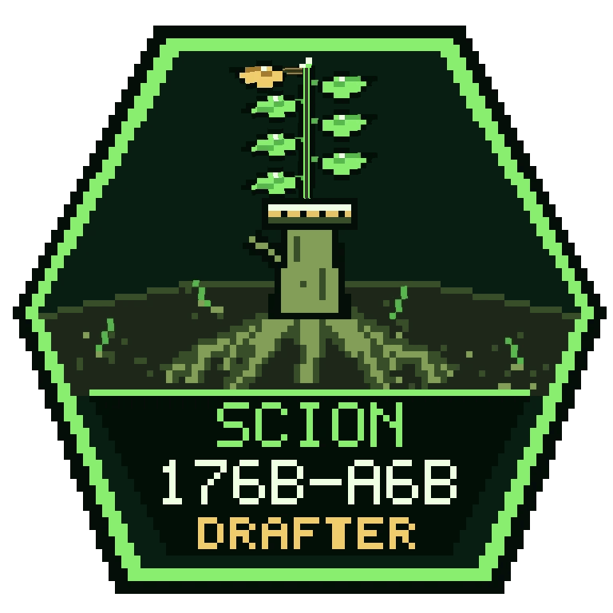

# Scion-FlashNext-176B-A6B — MTP drafters

<p align="center">
  
</p>

Two speculative-decoding drafters for the same
[**Scion-FlashNext-176B-A6B**](https://huggingface.co/SkyIsNotGreen/Scion-FlashNext-176B-A6B)
target (Q6_K, ternary/PTQ1_0 experts). They target different engines:

| file | size | engine |
| :--- | ---: | :--- |
| `scion-mtp-sidecar-v2.gguf` | 0.115 GB | **llama.cpp** — the fork's `draft-mtp` sidecar lane (below) |
| `Scion-FlashNext-176B-A6B-mtp-drafter.gguf` | 0.889 GB | **Strata** — the model's native MTP block, packed for [Strata](https://github.com/sky-is-green/strata) |

Pick the file that matches your engine. They are not interchangeable: the llama.cpp
lane takes the fc-head sidecar form, Strata takes the native full MTP layer.

---

## llama.cpp sidecar (`scion-mtp-sidecar-v2.gguf`)

A small fc-head drafter trained against this target's own head-input rows. For
every position the lane gives it the target's 2560-wide head-input row (the hc
mixer output) and the candidate token's embedding; it predicts the next token
through the target's own output projection. The third head (`fc3`) predicts the
draft's next head-input row, so the lane can chain up to three drafts per round
and verify them in one target pass.

The sidecar ships only the three head matrices (fp16) plus the target's
tokenizer: the token embeddings and the LM head are shared from the target at
runtime (`ctx_other`).

### Requirements

- A llama.cpp build with the `mtp-sidecar` architecture and the
  `--spec-type draft-mtp` lane — the fork branch **`engine/slotcache-sidecar`**
  at commit **`7e53b56be`** of
  [prism-ml-llama.cpp](https://github.com/sky-is-green/prism-ml-llama.cpp).
  That branch also contains the qwen4exp recurrent-snapshot rollback fix; without
  it the server falls back to the slower checkpoint path for partial acceptance.
- The target GGUF:
  [`Scion-FlashNext-176B-A6B-Q6_K.gguf`](https://huggingface.co/SkyIsNotGreen/Scion-FlashNext-176B-A6B).

### Setup

```console
hf download SkyIsNotGreen/Scion-FlashNext-176B-A6B \
    Scion-FlashNext-176B-A6B-Q6_K.gguf --local-dir .
hf download SkyIsNotGreen/Scion-FlashNext-176B-A6B-mtp-drafter \
    scion-mtp-sidecar-v2.gguf --local-dir .

# 2x 20 GB class cards, expert set not fully resident (see Benchmarks)
llama-server \
    -m Scion-FlashNext-176B-A6B-Q6_K.gguf \
    -md scion-mtp-sidecar-v2.gguf \
    --spec-type draft-mtp \
    -ngl 99 -ncmoe 24 -msc 256 -fa auto \
    -c 4096 -np 1 -t 8 \
    --host 127.0.0.1 --port 8080
```

Notes:

- `-ncmoe N` keeps the first N layers' expert banks in system RAM; `-msc N` keeps
  N hot experts per host layer in VRAM. Both are capacity knobs: if the model
  fits in VRAM, `-ncmoe 0` (and no `-msc`) is faster.
- On multi-GPU systems `-ts` follows llama.cpp's internal device vector, whose
  order can differ from the printed `ROCm*` order. Pin the order with
  `--device` (e.g. `--device ROCm0,ROCm1`) when the split matters.
- Speculative verification keeps the output unchanged: with greedy sampling the
  generated tokens are identical to the no-drafter run.

### Acceptance

Held-out probe windows, greedy, chained depth 4 (the chain continues through the
drafter's own `fc3` state):

| held-out set | first draft accepted | mean accepted length | tokens per target step |
| :--- | ---: | ---: | ---: |
| chat / reasoning (teacher rollouts, serving distribution) | **63.1%** | 0.81 drafts | **1.81** |
| wiki / code | 30.3% | 0.39 drafts | 1.40 |

In-engine cross-check on a wiki-style prompt: 1.53 tokens per target step
(32 accepted / 179 drafted, greedy).

The "first draft accepted" column is the probability that the first proposal is
correct; the tokens-per-step column is what a verifier actually gets. The second
proposal is accepted at 24% (given the first), the third at 15%.

### Speed

Warm, greedy, 64 tokens, same prompt, both arms on the same validation host:

| host | no drafter | + sidecar |
| :--- | ---: | ---: |
| 2x RX 7900 XT (20.5 GB each), 31 GB system RAM | 22.52 tok/s | 14.69 tok/s |

That host cannot hold the 176B's expert set in VRAM, so 24 layers' experts stay
in system RAM and the 4-token verify pass reads more host-resident experts per
step than a single-token decode. The drafter returns 1.53 tokens per step but the
step gets 2.3x more expensive, hence the net loss there.

**We have not measured a host where the expert set is resident** (64 GB+ RAM, or
a smaller target quantisation). The acceptance result is what transfers: at
1.4-1.8 tokens per target step, a resident configuration should see roughly a
1.4-1.8x decode speedup minus the small draft pass. Treat the speedup as
expected-but-unverified on such a host.

### What we could not check

- decode speed on a fully resident model host (above);
- acceptance under sampling (`temperature > 0`, top-p/top-k/MIN_P) — all
  measurements here are greedy;
- contexts longer than 4096 tokens;
- more than one server slot (`-np > 1`) or batched serving;
- other target quantisations, or targets other than this qwen4exp model;
- non-AMD backends.

Report any of these if you measure them — the card will be updated.

---

## Strata native pack (`Scion-FlashNext-176B-A6B-mtp-drafter.gguf`)

The target's own MTP block, packed for Strata. Qwen3.8-Flash-Next ships a
body-aligned MTP layer in its BF16 checkpoint, and llama.cpp's converter drops it
(`supports_mtp_export = false`), so it never made it into the released GGUFs.
This file packs it back for [Strata](https://github.com/sky-is-green/strata).

No fitting pass was run — the ternarisation preserved the hidden geometry well
enough that the native head transfers at full strength:

| Measurement | Result |
| :--- | :--- |
| Draft acceptance (weighted, 10 mixed greedy prompts, 256 tok each) | **0.741** (1310/1769), per-request 0.640–0.810 |
| Draft acceptance (30 real long-form generations, T 0.6) | 0.62–0.72 per request |
| Decode during those generations (2x RX 7900 XT, Q6_K, `--spec 4`) | 52–78 tok/s |
| Prefill, ~450-token prompts (same setup) | 116–135 tok/s |

Like all speculative decoding it is a **speed** option: the verifier checks every
draft against the target's own distribution, so outputs are unchanged apart from
rare near-tie flips on batched verification.

### Requirement: the Strata engine

> **This is not a llama.cpp drafter.** The file carries the native full MTP
> layer (attention, indexer, hyper-connections, 512 routed experts) in Strata's
> layout. Use `scion-mtp-sidecar-v2.gguf` for llama.cpp.

```console
hf download SkyIsNotGreen/Scion-FlashNext-176B-A6B Scion-FlashNext-176B-A6B-Q6_K.gguf --local-dir .
hf download SkyIsNotGreen/Scion-FlashNext-176B-A6B-mtp-drafter Scion-FlashNext-176B-A6B-mtp-drafter.gguf --local-dir .

# one-time: convert the GGUF to the engine runtime
python tools/mtp_rt.py --gguf Scion-FlashNext-176B-A6B-mtp-drafter.gguf --out mtp/rt

strata --serve --pack <pack-q6k> \
    --native Scion-FlashNext-176B-A6B-Q6_K.gguf \
    --ple-gguf Scion-FlashNext-176B-A6B-Q6_K.gguf \
    --embd-gguf scion-embd-bf16.gguf \
    --expert-profile data/expert-profile.bin --expert-cache auto \
    --prefill 4096 --max-context 8192 --ple-io direct --mmap-experts \
    --vram-reserve-mib 3072 --pool-workers 15 --pcie-frac 0 \
    --pipeline-windows 2 --layer-split auto \
    --mtp mtp/rt --spec 4 --spec-min-p 0.5
```

The native-IQ packs require the MTP lane (`--spec` >= 2), so on Strata this head
is both the speed option and the enabler for serving the ternary 176B on
consumer cards.

### Provenance (native pack)

The 31 `mtp.*` tensors were fetched from `Qwen/Qwen3.8-Flash-Next` @ revision
`de4b8e4d43b917e7706784d8bb445c9af86a3540` by HTTP range request (5.21 GB of the
360 GB checkpoint, 131 shards — only the named byte ranges), and every tensor was
verified against SHA256. The manifest with per-tensor shard, byte range and hash
ships in `mtp-manifest.json`. The pack is round-to-nearest Q2_0 for the routed
experts and BF16 for the dense tensors; the packer's report ships as
`mtp-q2_0.gguf.report.json`. No model runs, no distillation, no training:
provenance is the checkpoint itself.

---

## Files

| file | size | engine |
| :--- | ---: | :--- |
| `scion-mtp-sidecar-v2.gguf` | 0.115 GB | llama.cpp `draft-mtp` |
| `Scion-FlashNext-176B-A6B-mtp-drafter.gguf` | 0.889 GB | Strata native MTP |

SHA256 for every file in `SHA256SUMS.txt`.

## Training (llama.cpp sidecar)

- 360 teacher rollouts over the 360-prompt rollout corpus (452k tokens; the
  heldoutlab hard-90 and the easy-30 test split excluded by construction), plus
  8 wikitext/fineweb chunks (565k tokens) from the first corpus.
- Held out: 100 windows from each source (never trained on).
- fc1 5120x5120, fc2 2560x5120, fc3 2560x5120 (fp16 in the GGUF), GELU, RMS
  normalisation without a learned output norm (the target has none), 6144 steps,
  warm-started from a first-generation head, state-prediction loss weighted 1.0.
- The head is trained on the target's own greedy trajectory, which is why the
  acceptance is highest on the service distribution (chat/reasoning).

License Apache-2.0, inherited from the base model. The base model is
Qwen/Qwen3.8-Flash-Next (see the
[model card](https://huggingface.co/SkyIsNotGreen/Scion-FlashNext-176B-A6B)
for the quantization chain and the NOTICE).
